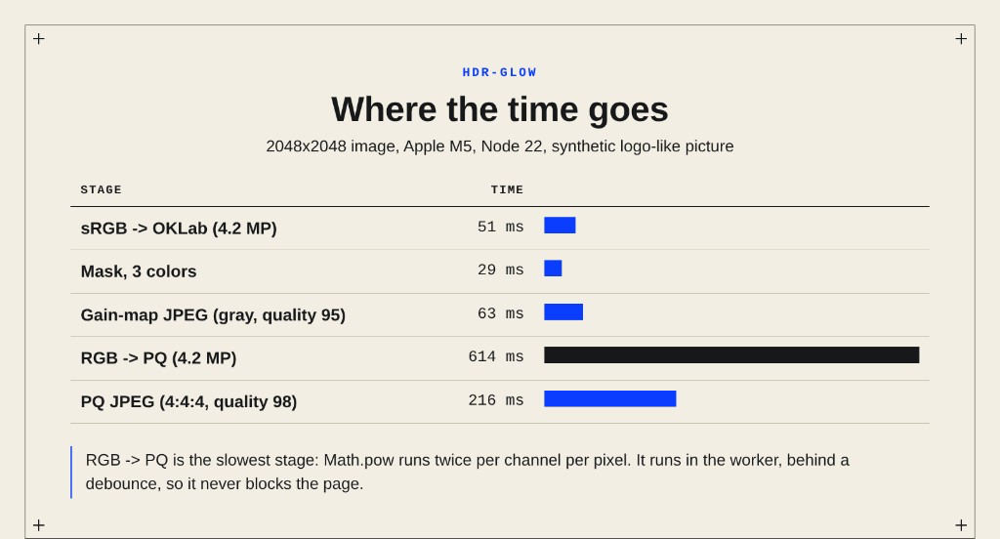

# Brighter than #fff: building an HDR logo tool in the browser

*A gain-map container, a JPEG encoder and a PQ color profile, written from scratch in TypeScript and running in a Web Worker. No backend, no image libraries.*

## What this is, in one minute

hdr-glow is a free browser tool that makes parts of a logo glow on HDR screens.

You upload a logo (PNG, JPEG, WebP, AVIF or SVG), pick which colors should glow, and download the result. The tool gives you two files:

- an HDR JPEG (an "Ultra HDR" gain-map JPEG) for websites, Chrome, Safari and Apple Photos;
- a PQ JPEG with a Rec.2100 color profile, made for LinkedIn.

It also makes text glow: a few lines of CSS and a 3 KB image.

Everything runs in the browser tab. Nothing is uploaded. The whole app is about 3,250 lines of TypeScript under src/, of which the JPEG encoder, the file container and the color profile are about 830, and the only runtime dependencies are React and two font packages. The production bundle is 257 kB of JavaScript (82 kB gzipped) plus an 18 kB worker. The deployed site scores 100 in all four Lighthouse categories and A+ on securityheaders.com.

Live: [glow.bereg.dev](https://glow.bereg.dev)

Source (MIT): [github.com/KonstantinBeregovoy/hdr-glow](https://github.com/KonstantinBeregovoy/hdr-glow)

The problem it solves. HDR screens can show white several times brighter than #fff. HDR photos and videos use that headroom. A logo on a web page or in a LinkedIn post cannot: as far as I could tell, no browser lets a CSS color go above SDR white. Next to an HDR photo, the logo looks flat. hdr-glow gives a logo a controlled amount of extra brightness, only where you want it, and degrades to a normal picture on a screen without HDR.

This article is the long version: what is inside those two files, why I wrote the pieces myself, the order I built things in, what went wrong, and how I checked that the glow is real without trusting my eyes.

## Decisions at a glance

If you read nothing else, these are the choices that shaped the project and where each is explained.

| Decision | Why | Section |
| --- | --- | --- |
| Frontend only, work in a Web Worker | privacy, and a frozen slider is not acceptable | 2, 10 |
| Write the gain-map container myself | the libraries I found did not write the ISO 21496-1 payload | 4 |
| Prove it byte for byte against a libultrahdr file | "it opens in Chrome" is a weak test | 4 |
| Write a JPEG encoder | canvas cannot write one channel and may color-manage pixels | 5 |
| Use canvas, at quality 1, for the base only | full-resolution color in Chrome keeps edges aligned with the mask | 5 |
| Match colors in OKLab, with a smoothstep falloff | a distance that follows the eye, and no visible seam | 6 |
| Suggest colors by hue family, tuned on real logos | brightness sorting never reached a second, darker hue | 7 |
| One mask drives both outputs, interpolated in stops | the gain map and the PQ file fade the same way | 8 |
| PQ at 203 nit white, Rec.2020, cicp tag, clipped fallback curve | HDR-aware software reads PQ, everything else still shows a sane picture | 8 |
| Read files back with macOS's own decoder | an SDR screen shows white for 1.0 and 7.5 alike | 9 |
| Typed worker protocol, newest request wins, one mask for three jobs | responsive sliders without wasted work | 10 |
| A Markdown twin of the page, generated from the same strings | crawlers that do not run JavaScript see an empty page | 11 |
| A CSP with no inline scripts, and the one inline style allowed by hash | stricter than 'unsafe-inline', and a test keeps the hash honest | 11 |
| Say what is claimed and what is measured | the "real glow" message checks support, not brightness | 10, 13 |

## Contents

1. [Two ways to put HDR into a JPEG](#1-two-ways-to-put-hdr-into-a-jpeg)
2. [Ground rules and the order of work](#2-ground-rules-and-the-order-of-work)
3. [Step 1: text first, with a 3 KB image](#3-step-1-text-first-with-a-3-kb-image)
4. [Step 2: the gain-map container, byte for byte](#4-step-2-the-gain-map-container-byte-for-byte)
5. [Step 3: a JPEG encoder, because canvas cannot](#5-step-3-a-jpeg-encoder-because-canvas-cannot)
6. [Step 4: the glow mask in OKLab](#6-step-4-the-glow-mask-in-oklab)
7. [Step 5: suggesting colors automatically](#7-step-5-suggesting-colors-automatically)
8. [Step 6: PQ for LinkedIn](#8-step-6-pq-for-linkedin)
9. [Verifying the glow without trusting my eyes](#9-verifying-the-glow-without-trusting-my-eyes)
10. [The app around the encoder](#10-the-app-around-the-encoder)
11. [Shipping it](#11-shipping-it)
12. [Quality work: CI, linting, and a review that found real bugs](#12-quality-work-ci-linting-and-a-review-that-found-real-bugs)
13. [Honest limits and what I would do next](#13-honest-limits-and-what-i-would-do-next)

## 1. Two ways to put HDR into a JPEG

A normal JPEG stores 8 bits per channel and encodes brightness relative to SDR white. Nothing in it can mean "brighter than white". To carry HDR in a JPEG you need one of two tricks.

### The gain map

The file holds a normal SDR picture plus a second, grayscale picture called the gain map, and some metadata. An HDR-aware viewer multiplies each SDR pixel by a factor taken from the gain map:

HDR pixel = SDR pixel * 2^(gain * stops * weight)

gain is the gain-map value from 0 to 1, stops is the maximum boost in stops (a factor of two each), and weight is a number between 0 and 1 that depends on how much headroom the screen has right now. A viewer that does not know about gain maps ignores the second image and shows the SDR picture. That is the whole appeal: the file is an ordinary JPEG everywhere, and HDR where it can be.

The standards involved are Adobe's gain-map XMP, Google's Ultra HDR container, and ISO 21496-1. It works in Chrome 137+, Safari 26 and iOS 26, and Apple Photos, which are the ones I tested.

### PQ pixels

The other way is to write absolute brightness into the pixels. PQ (SMPTE ST 2084) is a transfer curve that maps a signal from 0 to 1 onto 0 to 10,000 nits. A PQ picture needs a color profile that says "these values are PQ in Rec.2020 primaries". Without it, a viewer reads the values as ordinary sRGB, and the picture looks dark and flat.

I built both because they fail differently. A gain map depends on a second image and metadata surviving the trip. A PQ file puts the brightness in the pixels and needs only the profile. I made the PQ file for LinkedIn. I do not know what LinkedIn's image pipeline does internally, and I have not seen it documented. What I know is that the PQ file glows in its app, and the reasoning is that a platform that re-encodes images has a better chance of keeping pixels and a profile than a second embedded image.

| Aspect | Gain-map JPEG | PQ JPEG |
|---|---|---|
| What carries the brightness | a second grayscale image | the pixels themselves |
| What a non-HDR viewer sees | a normal picture | a normal picture clipped at white in color-managed software, dark and flat where the profile is stripped |
| Needs to survive | XMP, ISO payload, MPF index, second image | the ICC profile |
| Used here for | websites, Apple Photos | LinkedIn |

## 2. Ground rules and the order of work

Two rules shaped everything:

1. Frontend only. No server, no upload, no account. It is a portfolio piece and also the honest answer to "where does my logo go": nowhere.
2. No image libraries for the parts that matter. This was not purity. It came out of a short spike (section 4) that showed the libraries I could find did not write the files I needed.

The order I actually worked in:

1. A text demo first: background-clip: text over a tiny gain-map JPEG, with the exact HTML and CSS to copy. Verified on a real HDR screen before anything else.
2. A spike on existing tools for writing gain-map JPEGs.
3. A reference file built with Google's libultrahdr, to compare my output against.
4. My own container assembler, tested byte for byte against that reference.
5. My own JPEG encoder (one channel for the gain map, three for PQ).
6. The glow mask in OKLab and the pipeline in a Web Worker.
7. The UI: upload, color picking, sliders, a simulated preview for screens that cannot show HDR.
8. PQ output with its own ICC profile, and a Swift tool to read it back the way macOS does.
9. Automatic color suggestion, rewritten twice after testing on real logos.
10. Deployment, SEO, link previews, a Markdown twin and security headers, with CI, linting and a code review along the way.

I started with text because it was the smallest thing that proved the premise. If a 3 KB image could make a headline glow on my own screen, the rest was worth building. If not, I had lost very little.

## 3. Step 1: text first, with a 3 KB image

CSS cannot ask for a color above white. But CSS can clip a background image to the shape of the letters, and a background image can be an HDR JPEG:

```css
.hdr-glow-text {
  color: #fff; /* SDR fallback */
}

@media (dynamic-range: high) {
  @supports (background-clip: text) or (-webkit-background-clip: text) {
    .hdr-glow-text {
      background: url("hdr-glow-swatch-7.5x.jpg") center / cover;
      -webkit-background-clip: text;
      background-clip: text;
      color: transparent;
    }
  }
}
```

The text becomes a window onto a picture that is brighter than white. The three guards matter:

- color: #fff is the fallback for everything that does not match the rest.
- @media (dynamic-range: high) keeps the trick away from SDR screens, where text filled with a white picture would be no better than white text and would cost a request.
- @supports keeps it away from browsers without background-clip: text, where color: transparent would make the text vanish.

The image is a 64x64 flat white JPEG with a uniform gain map at maximum boost. It weighs 3,421 bytes. The page shows the same CSS string it injects into itself, so what you copy is what you see:

```ts
// src/snippets.ts
export const HDR_CSS = `.${HDR_CLASS} {
  color: #fff; /* SDR fallback */
}
...`;
```

The page uses its own trick. The h1, the section titles and the footer wordmark carry that same class, and the CSS is injected into the page as a <style> element from the same string. On an HDR screen the site's headings glow with the same 3 KB file that the visitor can download. If the technique broke, the site itself would show it first.

Later I added a slider that makes the same swatch at any strength from 1.5x to 7.5x. Because the swatch is tiny, it is rebuilt on every slider move, with no debounce and no worker:

```ts
// src/tool/swatch.ts
export function buildSwatch(boost: number): Uint8Array {
  const white = new Uint8Array(SWATCH_SIZE * SWATCH_SIZE * 3).fill(255);
  const base = encodeRgbJpeg(white, SWATCH_SIZE, SWATCH_SIZE, 100);
  const full = new Uint8Array(SWATCH_SIZE * SWATCH_SIZE).fill(255);
  const gainMap = encodeGrayJpeg(full, SWATCH_SIZE, SWATCH_SIZE, 95);
  return assembleGainMapJpeg({ base, gainMap, maxBoost: boost });
}
```

Here the base is encoded by my own encoder, not by canvas: a flat white square needs nothing from the browser. In the real tool the base comes from canvas (section 5).

That function is also the best summary of the file format: a base, a gain map, a number. Everything below explains how those three become one file.

## 4. Step 2: the gain-map container, byte for byte

### The spike

My first plan was to use a library. I looked at what I could find:

- @monogrid/gainmap-js 3.4.0 has an encodeJPEGMetadata function. It is pure JavaScript, but it writes only XMP and MPF. It does not write the ISO 21496-1 payload.
- libultrahdr-wasm exposed only an appendGainMap function, had no npm package, and said "as-is".

Different readers look for different metadata: some read Adobe's XMP, newer ones read the ISO 21496-1 payload. A file with only one of them can work in one app and quietly do nothing in another. I wanted both, as the reference file has.

So I wrote a small assembler. Before trusting it, I needed ground truth.

### The reference

I built Google's libultrahdr, made a white 64x64 base JPEG and a 64x64 gray gain-map JPEG, and had libultrahdr combine them at a boost of 7.5. That file is the reference. (The steps are in tools/make-swatch/README.md.) It also ships as the text-demo swatch.

### What is in the file

A gain-map JPEG is two JPEGs in one file. This is the layout my assembler produces:

```text
Primary image
  FFD8        SOI
  FFE0        JFIF
  FFE1        XMP: Container directory (Primary + GainMap, with the second image's length)
  FFE2        ICC profile (sRGB)
  FFE2        ISO 21496-1 payload (4 bytes for the primary image)
  ...         the base's own DQT, SOF, DHT segments
  FFE2        MPF index (two images: sizes and the second one's offset)
  FFDA ...    SOS and the base's scan data
  FFD9        EOI
Gain map image
  FFD8        SOI
  FFE1        XMP: hdrgm:GainMapMax, Gamma, offsets, HDRCapacityMax
  FFE2        ISO 21496-1 payload (61 bytes: min, max, gamma, offsets)
  ...         the gain map's own JPEG segments and scan
  FFD9        EOI
```

The assembler works on bytes. It reads a JPEG's marker segments up to the start of scan, drops any existing APP1 and APP2 segments, and splices in its own:

```ts
/** Marker segments up to and including the first SOS, which runs to the end of the data. */
function readSegments(jpeg: Uint8Array): Segment[] {
  if (jpeg[0] !== 0xff || jpeg[1] !== 0xd8) throw new Error("Not a JPEG");
  const view = new DataView(jpeg.buffer, jpeg.byteOffset, jpeg.byteLength);
  const segments: Segment[] = [];
  let position = 2;
  for (;;) {
    if (position + 4 > jpeg.length || jpeg[position] !== 0xff) throw new Error("Broken JPEG");
    const marker = jpeg[position + 1];
    if (marker === MARKER_SOS) {
      segments.push({ marker, start: position, end: jpeg.length });
      return segments;
    }
    const end = position + 2 + view.getUint16(position + 2);
    if (end > jpeg.length) throw new Error("Broken JPEG");
    segments.push({ marker, start: position, end });
    position = end;
  }
}

/** The JPEG without APP1 (Exif, XMP) and APP2 (ICC, MPF) segments. */
function stripMetadata(jpeg: Uint8Array): Uint8Array {
  const parts = [jpeg.subarray(0, 2)];
  for (const segment of readSegments(jpeg)) {
    if (segment.marker === MARKER_APP1 || segment.marker === MARKER_APP2) continue;
    parts.push(jpeg.subarray(segment.start, segment.end));
  }
  return concat(parts);
}
```

Stripping first has a practical reason: the base comes from the browser's own canvas encoder, which may or may not add metadata, and the output must not depend on that.

The same goes for the sRGB profile in the primary image. libultrahdr embeds a 588-byte profile, so container.ts carries that exact profile as a base64 constant and writes it, rather than generating an equivalent one. A different but valid profile would have broken the byte comparison below for no benefit.

### The gain-map XMP

The second image carries the parameters a viewer needs, as XMP attributes. With a minimum gain of 0, a gamma of 1 and no offsets, the only numbers that change are the boost, written in stops:

```xml
<rdf:Description
  rdf:about=""
  xmlns:hdrgm="http://ns.adobe.com/hdr-gain-map/1.0/"
  hdrgm:Version="1.0"
  hdrgm:GainMapMin="0"
  hdrgm:GainMapMax="2.90689"
  hdrgm:Gamma="1"
  hdrgm:OffsetSDR="0"
  hdrgm:OffsetHDR="0"
  hdrgm:HDRCapacityMin="0"
  hdrgm:HDRCapacityMax="2.90689"
  hdrgm:BaseRenditionIsHDR="False"/>
```

2.90689 is log2(7.5). The code prints six significant figures because that is what libultrahdr prints, and matching its text exactly is what makes the byte comparison possible:

```ts
/** Same digits libultrahdr prints: 6 significant figures. */
const formatStops = (stops: number) => String(Number(stops.toPrecision(6)));
```

### The ISO 21496-1 payload

The ISO version stores the same numbers as binary fractions. Gain values are written as numerator / 2^22:

```ts
const ISO_DENOMINATOR = 2 ** 22;

function isoGainMapPayload(stops: number): Uint8Array {
  const numerator = Math.round(stops * ISO_DENOMINATOR);
  // ...
  u16(0); // minimum version
  u16(0); // writer version
  out[offset++] = 0x40; // flags, same value as the reference file
  u32(0); // base headroom, 0 / 1
  u32(1);
  u32(numerator); // alternate headroom
  u32(ISO_DENOMINATOR);
  i32(0); // gain map min, 0 / 1
  u32(1);
  i32(numerator); // gain map max
  u32(ISO_DENOMINATOR);
  u32(1); // gamma 1 / 1
  u32(1);
  i32(0); // base offset 0 / 1
  u32(1);
  i32(0); // alternate offset 0 / 1
  u32(1);
  return out;
}
```

For a boost of 7.5 the numerator is 12,192,383. The flags byte is not something I derived from the spec. I copied it from the reference file, and the comment says so. When you are matching another implementation byte for byte, "same as the reference" is a legitimate reason.

### The MPF index, and a circular dependency

The Multi-Picture Format index tells a reader where the second image starts. It has one awkward property: its offsets depend on the size of the file, including the size of the index itself.

The first image's XMP needs the length of the second image. That is known up front. The MPF segment needs the length of the first image, which includes the MPF segment. The way out is that the MPF segment has a fixed size (an 86-byte body: three IFD entries and two image entries), so the arithmetic is not actually circular:

```ts
// 4 = marker + length, 8 = the same plus "MPF\0" (the offset base "MM" comes after it)
const primaryLength = head.length + middle.length + 4 + MPF_BODY_LENGTH + tail.length;
const byteOrderMark = head.length + middle.length + 8;
const primary = concat([
  head,
  middle,
  mpfSegment(primaryLength, secondary.length, primaryLength - byteOrderMark),
  tail,
]);
return concat([primary, secondary]);
```

The offset of the second image is counted from the MM byte-order mark inside the MPF segment, not from the start of the file. That detail is easy to get wrong.

### The test that makes all of this trustworthy

"It opens in Chrome" is a weak test. Readers are forgiving in different ways, and a file that two of them accept can still be wrong. The strongest check I could think of was this: rebuild the reference file from its own parts and compare every byte.

```ts
test("container: hdr-glow-swatch-7.5x.jpg is rebuilt byte for byte", () => {
  const rebuilt = assembleGainMapJpeg({
    base: reference.subarray(0, cut),       // the reference's base JPEG
    gainMap: reference.subarray(cut),       // the reference's gain-map JPEG
    maxBoost: 7.5,
  });
  assert.equal(rebuilt.length, reference.length);
  assert.ok(Buffer.from(rebuilt).equals(Buffer.from(reference)), "bytes differ");
});
```

A second test checks that other boosts change only the numbers: at a boost of 4, log2 is exactly 2, so the text shrinks by a known number of characters and the total length drops by exactly 12 bytes.

If my assembler is wrong in any single byte, the first test fails. If it is right, the output is indistinguishable from what Google's reference implementation writes. That is a much stronger statement than "it opened".

## 5. Step 3: a JPEG encoder, because canvas cannot

The container needs two JPEGs: a base and a gain map. The base is easy: the canvas convertToBlob call writes a normal one. The gain map is the problem, and so is the PQ picture later.

### Why not just use canvas

What I found when I tried it:

- Canvas writes three-component JPEGs. A gain map is one channel (grayscale). The reference file's gain map has one component, and I wanted to match it.
- Canvas can color-manage pixels. For a gain map that is harmless. For a PQ picture it is fatal: the whole point is that specific byte values mean specific brightnesses, and a color-managed path may change them.

So the encoder writes exactly the bytes it is given. It is a baseline JPEG encoder: standard tables, no chroma subsampling, JFIF header. About 300 lines.

### What a baseline JPEG encoder does

For each 8x8 block of each channel:

1. Level shift: subtract 128.
2. DCT: turn the 64 pixels into 64 frequency coefficients.
3. Quantize: divide each coefficient by a table entry and round. This is where quality is lost.
4. Zigzag: reorder the coefficients from low to high frequency, so runs of zeros collect at the end.
5. Entropy code: write the DC coefficient as a difference from the previous block, and the AC coefficients as (zero-run, size) symbols through a Huffman table.

The DCT is done as two passes of an 8x8 matrix multiply, using a precomputed basis:

```ts
// DCT basis, so that coefficients = BASIS * block * BASIS^T.
const BASIS = new Float64Array(64);
for (let u = 0; u < 8; u++) {
  for (let x = 0; x < 8; x++) {
    BASIS[u * 8 + x] =
      (u === 0 ? Math.SQRT1_2 : 1) * 0.5 * Math.cos(((2 * x + 1) * u * Math.PI) / 16);
  }
}
```

That is not the fastest way to do a DCT (a fast factorized version is faster), but it is short, clearly correct, and fast enough: on this machine a 2048x2048 gain map encodes in about 63 ms in Node. Speed was never the constraint for this stage.

### Quality

The quality number maps to a quantization table the way libjpeg does it. Quality 50 is the standard table, lower scales it up, higher scales it down:

```ts
const q = Math.min(100, Math.max(1, Math.round(quality)));
const scale = q < 50 ? 5000 / q : 200 - q * 2;
const quant = BASE_QUANT.map((value) =>
  Math.min(255, Math.max(1, Math.floor((value * scale + 50) / 100))),
);
```

At quality 100, scale is 0 and every table entry clamps to 1, so every step of the input survives. The swatch's white base uses 100, the gain map uses 95 and the PQ picture uses 98.

### The bit writer and byte stuffing

The entropy-coded data is a bit stream, so a small writer accumulates bits and emits bytes. JPEG has one rule here that is easy to forget: a 0xFF byte in the scan data would look like a marker, so it must be followed by a 0x00.

```ts
write(code: number, size: number) {
  if (size === 0) return;
  this.accumulator = (this.accumulator << size) | (code & ((1 << size) - 1));
  this.bitCount += size;
  while (this.bitCount >= 8) {
    this.bitCount -= 8;
    const byte = (this.accumulator >> this.bitCount) & 0xff;
    this.push(byte);
    if (byte === 0xff) this.push(0); // byte stuffing
  }
  this.accumulator &= (1 << this.bitCount) - 1;
}
```

The run-length part of the entropy coding has two special symbols: 0xF0 (sixteen zeros in a row) and 0x00 (the rest of the block is zeros):

```ts
let run = 0;
for (let i = 1; i < 64; i++) {
  const value = zigzagged[i];
  if (value === 0) { run++; continue; }
  while (run > 15) {
    bits.write(ac.codes[0xf0], ac.sizes[0xf0]);
    run -= 16;
  }
  const size = bitLength(Math.abs(value));
  const symbol = (run << 4) | size;
  bits.write(ac.codes[symbol], ac.sizes[symbol]);
  bits.write(value < 0 ? value - 1 : value, size);
  run = 0;
}
if (run > 0) bits.write(ac.codes[0x00], ac.sizes[0x00]);
```

### Two shortcuts the format allows

- One table set for every channel. Baseline JPEG allows each component to name its own quantization and Huffman tables, but it does not require it. Every channel here uses the standard luminance tables. For a gain map (one channel) that is correct anyway. For the PQ picture it keeps the encoder simple.
- No chroma subsampling (4:4:4). Subsampling halves the color resolution, which smears saturated edges. For the PQ picture the three channels carry absolute brightness, so I keep full color resolution instead of letting subsampling smear saturated edges.

The RGB path converts to YCbCr with the standard JFIF coefficients before encoding:

```ts
y[i]  = clampByte(0.299 * r + 0.587 * g + 0.114 * b);
cb[i] = clampByte(-0.168736 * r - 0.331264 * g + 0.5 * b + 128);
cr[i] = clampByte(0.5 * r - 0.418688 * g - 0.081312 * b + 128);
```

### The base image and a quirk I did find in Chrome

The base image is drawn by canvas, and I ask for the highest quality:

```ts
// Chrome switches from 4:2:0 to full-resolution color only at quality 1, and
// subsampled color would smear saturated edges away from the mask.
const BASE_QUALITY = 1; // canvas quality is 0 to 1
const blob = await this.flat.convertToBlob({ type: "image/jpeg", quality: BASE_QUALITY });
```

This is what I found in Chrome: below quality 1, color is subsampled 4:2:0, and a saturated edge can then be blurred outward from where the mask says the glow stops. A gain map is spatially exact; the base underneath it should be too. I did not write my own encoder for the base: it is an ordinary three-channel picture, which is exactly what canvas writes, so there was nothing to replace.

## 6. Step 4: the glow mask in OKLab

The mask answers one question per pixel: how much of the boost should this pixel get? It is 0 to 255, and it is used as the gain map as it is: 0 means no boost, 255 means the full boost.

### Why OKLab

"Is this pixel close to the color the user picked?" sounds like a distance in RGB. It is a bad distance: equal steps in RGB are not equal steps for the eye, and green looks very different from blue at the same numeric gap. OKLab is a color space designed so that Euclidean distance roughly matches perceived difference. That makes a single "color range" slider behave consistently for a pale gold and for a deep blue.

The conversion is sRGB to linear light, then to a cone-like space, a cube root, and a final matrix:

```ts
const LINEAR = new Float32Array(256);
for (let i = 0; i < 256; i++) {
  const c = i / 255;
  LINEAR[i] = c <= 0.04045 ? c / 12.92 : ((c + 0.055) / 1.055) ** 2.4;
}

function oklab(r: number, g: number, b: number, out: Float32Array | number[], offset: number) {
  const lr = LINEAR[r];
  const lg = LINEAR[g];
  const lb = LINEAR[b];
  const l = Math.cbrt(0.4122214708 * lr + 0.5363325363 * lg + 0.0514459929 * lb);
  const m = Math.cbrt(0.2119034982 * lr + 0.6806995451 * lg + 0.1073969566 * lb);
  const s = Math.cbrt(0.0883024619 * lr + 0.2817188376 * lg + 0.6299787005 * lb);
  out[offset] = 0.2104542553 * l + 0.793617785 * m - 0.0040720468 * s;
  out[offset + 1] = 1.9779984951 * l - 2.428592205 * m + 0.4505937099 * s;
  out[offset + 2] = 0.0259040371 * l + 0.7827717662 * m - 0.808675766 * s;
}
```

The 256-entry lookup table for the sRGB curve avoids a pow per channel per pixel. The whole picture is converted once on load (51 ms for 4.2 megapixels) and kept as a Float32Array, so every later slider move only has to compare numbers.

### The mask itself

For each pixel, find the nearest chosen color in OKLab. Then turn the distance into a strength with a smooth falloff:

```ts
const inner = tolerance * (1 - softness);
const span = tolerance - inner;

for (let i = 0; i < pixels; i++) {
  // ...nearest chosen color, squared distance in OKLab...
  const distance = Math.sqrt(nearest);
  let strength: number;
  if (distance <= inner) strength = 1;
  else if (distance >= tolerance) strength = 0;
  else {
    const t = (distance - inner) / span;
    strength = 1 - t * t * (3 - 2 * t); // smoothstep
  }
  out[i] = Math.round(strength * alpha[i]);
}
```

- tolerance is the OKLab distance at which a pixel stops glowing. The UI shows it as a percentage of its range.
- softness decides how much of that distance is a fade instead of a hard edge. At 0 the edge is hard; at 1 the fade starts at the chosen color itself.
- The fade is a smoothstep (3t^2 - 2t^3), which has zero slope at both ends, so there is no visible seam where the glow starts or ends.
- The strength is multiplied by the pixel's alpha, so transparent areas never glow. Alpha is read from a separate transparent draw, so that a background color cannot hide it.

Transparent logos need one more thing: JPEG cannot store transparency. The tool flattens the picture onto a background color first, and the user picks that color to match the page the image will sit on. The page says so right next to the picker.

## 7. Step 5: suggesting colors automatically

The first thing a visitor sees after dropping in a logo should not be an empty list. The tool should guess which colors are "meant to glow". That turned out to be the part I rewrote the most, and the lesson was about testing against real inputs.

I tested on three of my own logos and counted something very concrete: how many manual clicks it took to reach a good result, then how many the automatic suggestion saved.

### Version 1: the most common light color

The first version picked the most common light color. On a white-on-dark logo that is fine. On a gradient or a two-color logo it is not: the user had to click the rest by hand. Reaching a good result manually took four clicks on Lighthouse, three on KB Tech and seven on Arctic Solutions. That was the target the automatic suggestion had to match.

### Version 2: several shades

Next, the algorithm took the several most common light shades. That fixed the metallic gradient. It still failed on a logo with a second, different color: Arctic Solutions has a tan bear and a green wreath. The green is darker and rarer than any shade of tan, so sorting by brightness never reached it.

### Version 3: color families

The fix was to stop sorting shades and start grouping by hue. Each pixel goes into a family: neutral (white or gray), or one of twelve 30-degree hue bins in OKLab. Families are ranked by how much of the image they cover, and each contributes a few of its own most common shades:

```ts
// (comments shortened)
const NEUTRAL_LIGHT = 0.7;    // white/gray only counts when it is genuinely bright
const CHROMA_LIGHT = 0.5;     // a saturated color reads as "meant to glow" at a lower lightness
const CHROMA_MIN = 0.04;      // below this chroma a pixel has no real hue
const HUE_BINS = 12;          // 30 degrees each
const MAX_FAMILIES = 3;       // neutral plus at most this many hues
const SHADES_PER_FAMILY = 3;
const MAX_SUGGESTIONS = 6;
const MIN_SHARE = 0.002;      // ignore a shade, or a family, this rare
const MAX_SHARE = 0.6;        // this common is the background
const WHITE_DISTANCE = 0.05;  // close enough to white snaps to white
const MERGE_DISTANCE = 0.08;  // two candidates this close are the same shade
```

Pixels are bucketed by their top four bits per channel (4,096 buckets), so counting is a single pass:

```ts
const chroma = Math.hypot(a, b);
let family: number;
if (chroma < CHROMA_MIN) {
  if (L < NEUTRAL_LIGHT) continue;
  family = NEUTRAL_FAMILY;
} else {
  if (L < CHROMA_LIGHT) continue;
  family = Math.floor(((Math.atan2(b, a) + Math.PI) / (2 * Math.PI)) * HUE_BINS) % HUE_BINS;
}
const key = ((r >> 4) << 8) | ((g >> 4) << 4) | (bl >> 4);
counts[key]++;
```

White is placed first whenever the image has some that is not the background. The test is simple: the bucket where all three channels are at least 240 (0xfff in the key above) must be populated, belong to the neutral family, and not be so common that it is the background. The rest are ranked by coverage, and near-duplicates are merged by OKLab distance.

Two small choices make the suggestions usable. A suggested color is the average of the pixels in its bucket, not the bucket's center, so it is the real color from the logo and not a rounded one. And anything within 0.05 of white in OKLab snaps to exactly white, so a near-white that comes from antialiasing or JPEG noise does not become a second, almost identical chip.

### The threshold I got wrong first

CHROMA_LIGHT was 0.45. On KB Tech, that let a dark teal (lightness 0.479) into the suggestions, and the teal was not part of the logo at all: it was the JPEG's own noise in the background. Raising the floor to 0.5 removed it while staying below the darkest shade I did want from Arctic Solutions (0.536). The lesson is that a threshold is a claim about the data, and the only way to check it is to put real data through it.

### The result

| Logo | Before (manual) | Suggested automatically | Glow area |
|---|---|---|---|
| Lighthouse | 4 clicks | 3 colors | 5% |
| KB Tech | 3 clicks | 3 colors | 8% |
| Arctic Solutions | 7 clicks | 6 colors | 11% |

All three match what I got by clicking by hand, with zero clicks. The algorithm is covered by tests with synthetic images, including the cases that broke it: a white shape on transparency, a metallic gradient, near-duplicate shades, and a green logo on black.

The suggestions are only a starting point. Under the color list there is a hex field to add an exact color by typing it, and a row of "found in the image" chips to bring back any suggestion the user removed. The list is capped at 12 colors, because the mask costs time per color per pixel.

## 8. Step 6: PQ for LinkedIn

The PQ picture has no second image: the glow is written straight into the pixels as absolute brightness.

### The curve

PQ is defined by five constants and two formulas. The encoder turns nits into a signal between 0 and 1, and the decoder turns it back:

```ts
const M1 = 2610 / 16384;
const M2 = (2523 / 4096) * 128;
const C1 = 3424 / 4096;
const C2 = (2413 / 4096) * 32;
const C3 = (2392 / 4096) * 32;

/** PQ signal (0 to 1) for a brightness in nits. */
export function pqEncode(nits: number): number {
  const y = Math.pow(Math.max(0, nits) / 10000, M1);
  return Math.pow((C1 + C2 * y) / (1 + C3 * y), M2);
}
```

A test checks this against the reference points of ST 2084 and BT.2408.

### Where "white" goes

A PQ picture is absolute, so the encoder has to decide how bright SDR white is. I use 203 nits, the reference white from ITU-R BT.2408. Every pixel keeps the brightness it has in sRGB, scaled so white lands at 203 nits, and then glowing pixels are multiplied by the same gain a gain map would apply:

```ts
const gains = new Float64Array(256);
for (let i = 0; i < 256; i++) gains[i] = 2 ** ((stops * i) / 255) * whiteNits;
```

That table is the bridge between the two formats: the mask value is an index into it. Mask 0 gives 203 nits, mask 255 gives 203 * 7.5 = 1,522.5 nits. One mask, two outputs.

Notice that the table interpolates in stops, not in multiples: 2 ** (stops * i / 255). A gain map works in the log domain, so a half-strength mask gives half the stops, which is 2.75x, not 4.25x (the halfway point of a 1x to 7.5x scale). The PQ encoder copies that behavior on purpose, so a soft edge fades the same way in both files and the two outputs look alike. There is a test for it: a half mask must boost by half the stops, within 0.03 of a stop. It is also why the UI works in stops internally (Math.log2(boost) goes to the worker) while the slider shows a plain multiplier.

The pixels also change primaries. The page works in sRGB (Rec.709 primaries), PQ pictures are normally Rec.2020, so each pixel goes through linear light and a 3x3 matrix (ITU-R BT.2087):

```ts
const R = [0.6274039, 0.329283, 0.0433131];
const G = [0.0690973, 0.9195404, 0.0113623];
const B = [0.0163914, 0.0880133, 0.8955953];

for (let i = 0; i < pixels; i++) {
  const r = SRGB_TO_LINEAR[rgba[i * 4]];
  const g = SRGB_TO_LINEAR[rgba[i * 4 + 1]];
  const b = SRGB_TO_LINEAR[rgba[i * 4 + 2]];
  const gain = gains[mask[i]];
  out[i * 3]     = Math.round(pqEncode(gain * (R[0] * r + R[1] * g + R[2] * b)) * 255);
  out[i * 3 + 1] = Math.round(pqEncode(gain * (G[0] * r + G[1] * g + G[2] * b)) * 255);
  out[i * 3 + 2] = Math.round(pqEncode(gain * (B[0] * r + B[1] * g + B[2] * b)) * 255);
}
```

### The eight-bit problem

A JPEG has 8 bits per channel. PQ spreads 0 to 10,000 nits across them, so the steps are coarse near the top. I measured the codes around the target:

- 7.5x white is 1,522.5 nits, which is signal 0.79768, which rounds to code 203.
- Code 203 (out of 255) decodes to 7.39x white, not 7.5x.
- Its neighbors decode to 7.13x and 7.66x, so one code step at that brightness is about 3.5 to 3.7 percent.

So the best a PQ JPEG can do for "7.5x" is 7.39x, and a mask value in between lands on the nearest representable step. There is no dithering, so a smooth gradient can show steps.

### The color profile

A PQ file needs an ICC profile with a cicp tag. The profile is generated in code from the Rec.2020 primaries and the PQ curve, not embedded as a binary blob, which is what lets a test check it (section 9). An ICC profile is a header, a tag table and tag data. The important parts:

- Primaries: Rec.2020, written as red, green and blue XYZ colorants adapted from D65 to D50 (the ICC connection space) with the Bradford matrix.
- cicp tag: four bytes, 9, 16, 0, 1: BT.2020 primaries, PQ transfer, RGB (identity matrix), full range. This is what HDR-aware software looks for.

```ts
const cicpTag = () => {
  const w = new Writer();
  w.ascii("cicp");
  w.u32(0);
  w.bytes.push(9, 16, 0, 1); // BT.2020 primaries, PQ, RGB, full range
  return w.bytes;
};
```

- A fallback curve (rTRC, gTRC, bTRC) for software that ignores cicp. It is a 4,096-entry table that maps each PQ signal value to linear light measured against SDR white, and clips everything above SDR white. Software that reads cicp never looks at it. Software that does not shows the picture as an ordinary SDR image, clipped at white, rather than as garbage:

```ts
// The curve is for software that ignores the cicp tag: it shows the picture as
// an ordinary SDR one, with everything above SDR white clipped.
for (let i = 0; i < CURVE_ENTRIES; i++) {
  const nits = pqDecode(i / (CURVE_ENTRIES - 1));
  w.u16(Math.round(Math.min(1, nits / REFERENCE_WHITE_NITS) * 65535));
}
```

The three curve tags point at one shared copy of the data. The writer deduplicates tag bodies by identity, so the 8 KB table is stored once. The finished profile is 8,732 bytes, of which 8,204 are that curve.

There is one more failure mode. If a website or app strips the profile entirely, the viewer reads the PQ code values as sRGB, and the picture looks dark and flat. That is the real downside of this format, and it is why the page tells people to use the HDR JPEG where the profile is stripped.

The profile is inserted right after the JFIF header, replacing whatever metadata the JPEG had:

```ts
export function embedIccProfile(jpeg: Uint8Array, profile: Uint8Array): Uint8Array {
  if (profile.length > 65000) throw new Error("Profile is too large for one segment");
  const plain = stripMetadata(jpeg);
  const segments = readSegments(plain);
  const afterApp0 = segments[0].marker === MARKER_APP0 ? segments[0].end : 2;
  return concat([plain.subarray(0, afterApp0), iccSegment(profile), plain.subarray(afterApp0)]);
}
```

## 9. Verifying the glow without trusting my eyes

Looking at a screen to check an HDR effect is unreliable. An SDR screen shows white for 1.0 and for 7.5 alike. A screen with HDR switched off in the system does the same. A browser that cannot render HDR does the same. If I see "white", I learn nothing.

So I wrote a small Swift script, tools/hdr-probe/probe.swift. It asks macOS itself to decode a file with HDR requested, draws the result into an extended linear sRGB context, and prints the pixel values, where 1.0 is SDR white:

```swift
let options: [CFString: Any] = [kCGImageSourceDecodeRequest: kCGImageSourceDecodeToHDR]
guard let image = CGImageSourceCreateImageAtIndex(source, 0, options as CFDictionary) else { ... }
print("contentHeadroom \(image.contentHeadroom)")
// ...draw into extendedLinearSRGB with 16-bit float components, then read pixels
```

Then I ran it on files made by my own code (a 64x64 white picture at mask 255 and at mask 128, boost 7.5):

| File | What macOS decodes | Expected |
| --- | --- | --- |
| libultrahdr reference swatch | headroom 7.5, pixel 7.496 | 7.5 |
| gain-map JPEG from my assembler | headroom 7.5, pixel 7.496 | 7.5 |
| PQ JPEG, full mask | pixel 7.391 | 7.39 (8-bit step, section 8) |
| PQ JPEG, mask 128 | pixel 2.793 | 7.5^(128/255) = 2.749 |

Three things are worth noticing:

- My gain-map file decodes to exactly what the reference decodes to, headroom included. That is the byte-for-byte test paying off from a second direction.
- The PQ values match the 8-bit analysis. The half-mask value (2.793 against an ideal 2.749) is a 1.6 percent error, within one quantization step.
- For the PQ file macOS reports a content headroom of 4.9261084. That is exactly 1000/203, which I read as macOS assuming a 1,000-nit peak because the file does not declare one. That is my inference, not something I found documented.

On top of that:

- 32 automated tests (Vitest) cover the pure modules: the container, both JPEG encoders, PQ math, the ICC profile structure (valid header, tag table inside the file, cicp value, colorants adding up to D50), the mask, the color suggestion, the browser check, the hex parsing, the Markdown twin of the page, and the security headers (section 11).
- Real devices. The glow works in Chrome and Safari on a MacBook, in Apple Photos, in the LinkedIn app on a phone, and on a Samsung Galaxy S23. An older Xiaomi phone shows no glow. The page lists both results.

That last line is deliberate. A tool that says "works everywhere" is wrong about something, and the honest version is more useful to the reader.

## 10. The app around the encoder

### Architecture

```text
React state  ->  ImageWorker (page)  ->  postMessage  ->  Pipeline (worker)
   colors,           typed request       transferable        bitmap, OKLab copy,
   sliders,          per method,         buffers             alpha, mask,
   background        id per call                             both encoders
```

All the heavy work (OKLab conversion, mask, both JPEG encoders, PQ) runs in a Web Worker. This is not a premature optimization. The PQ encoding of a 4.2 megapixel picture took 614 ms in my Node measurement. On the main thread that is a frozen slider.

I measured each stage at 2048x2048 on an Apple M5 in Node 22, with a synthetic logo-like image:



| Stage | Time |
| --- | --- |
| sRGB to OKLab (4.2 MP) | 51 ms |
| mask, 3 colors | 29 ms |
| gain-map JPEG (gray, quality 95) | 63 ms |
| RGB to PQ (4.2 MP) | 614 ms |
| PQ JPEG (4:4:4, quality 98) | 216 ms |

The PQ conversion is by far the slowest stage, because it calls Math.pow twice per channel per pixel. A lookup table for the curve would be the first thing I would try. I did not, because the work runs in the worker, behind a debounce, so it never blocks the page.

### A typed protocol

The page and the worker talk through a small request/response protocol. Early on it was a loose union with result?: unknown and six casts like as Promise<LoadResult>. I replaced it with two maps: what each request carries, and what each resolves to.

```ts
export type Requests = {
  load: { bitmap: ImageBitmap; background: string };
  background: { background: string };
  pick: { x: number; y: number };
  preview: { params: MaskParams };
  build: { params: MaskParams; stops: number };
  buildPq: { params: MaskParams; stops: number };
};

export type Results = {
  load: LoadResult;
  background: void;
  pick: RGB;
  preview: PreviewResult;
  build: BuildResult;
  buildPq: BuildResult;
};

/** Requests where only the newest matters: an older one still queued is skipped. */
export type Skippable = "preview" | "build" | "buildPq";
```

ImageWorker.ask is overloaded on those maps, so every call site gets its exact result type, and the "newest wins" requests are typed as possibly null. The six casts are gone; one remains, at the postMessage boundary where TypeScript cannot follow.

### Newest wins

Dragging a slider fires dozens of preview and build requests. Computing all of them is wasted work, and the stale ones would arrive after the fresh one. The worker records the newest id of each kind and skips older ones that are still waiting in its queue:

```ts
const newest = { preview: 0, build: 0, buildPq: 0 };

scope.onmessage = (event) => {
  const request = event.data;
  if (request.type === "preview" || request.type === "build" || request.type === "buildPq") {
    newest[request.type] = request.id;
  }
  queue = queue.then(() => handle(request));
};
```

Requests still run one at a time, in order, so the worker's state never races with itself. A skipped request resolves to null, which the page treats as "nothing to do".

### One mask for three jobs

The preview, the HDR build and the PQ build used to each recompute the same mask for the same colors and sliders, so one slider position cost three passes over four million pixels. The mask is now keyed by its parameters and dropped when the picture or its background changes:

```ts
private updateMask({ colors, tolerance, softness }: MaskParams): void {
  const key = `${colors.map((c) => `${c.r},${c.g},${c.b}`).join(";")}|${tolerance}|${softness}`;
  if (key === this.maskFor) return;
  computeMask(this.lab, this.alpha, { colors, tolerance, softness }, this.mask);
  this.maskFor = key;
}
```

The output did not change: the Lighthouse sample is still 181 KB and 127 KB, with a 5 percent mask.

### Splitting one big component

ImageTool.tsx grew to 647 lines with 12 useState and 7 useEffect calls. I split it without changing the data flow:

- useImageSession: the worker, the loaded bitmap, the background, the pixel version, the error, and loadFile.
- useMaskPreview: the debounced mask canvas and its coverage.
- useBuiltFile and ResultCard: one built file and its card.
- DropZone, GlowColors, GlowSliders: the markup, each owning only its own local state.

The component is now 280 lines and mostly reads as a description of the screen.

### A preview for screens that cannot show HDR

Most visitors do not have an HDR screen set up. For them, the tool draws a simulated preview: on the masked pixels, scale each color until its brightest channel is full, keeping the hue, and add a soft blurred halo with additive blending:

```ts
const brightest = Math.max(pixels.data[offset], pixels.data[offset + 1], pixels.data[offset + 2]);
const scale = brightest > 0 ? 1 + (255 / brightest - 1) * lift : 1;
```

It is labeled for what it is: an SDR screen cannot show more than white, so the preview only suggests the effect.

### Knowing whether the glow on the page is real

The status line at the top says either "the glow on this page is real" or "this is only a preview". Two checks decide it:

- The screen: window.matchMedia("(dynamic-range: high)"), with a listener so moving the window to another monitor updates it.
- The browser: the user agent version must be Chrome or Edge 137+, or Safari or iOS 26+. Every browser on iOS uses WebKit, so on iOS the system version decides.

The honest caveat: this checks claimed support, not measured brightness. HDR switched off in the system settings, or a device that claims support but does not render it, can pass both checks and show nothing. So the sentence reads as a statement about capability, and the limits section says what that means.

### Reading the file: limits, SVG and the bitmap's lifetime

A browser tool that accepts files from strangers needs limits before it needs features. The file-size limits run before decoding, the pixel limit right after, and all of them before the worker sees anything:

- 30 MB for a raster file, 5 MB for an SVG (SVG is text, so a large one usually means embedded pictures);
- 100 megapixels, checked on the decoded size, because the browser's own decode can be the expensive part;
- anything larger than 2,048 pixels on the long side is scaled down before processing.

SVG needed its own path. Chrome cannot hand an SVG straight to createImageBitmap, so the file goes through an  and a canvas. That also has a security benefit: an  does not run scripts inside the SVG and does not load fonts or pictures it links to. The page says so, and tells the user to turn text into outlines first.

The path also has a trap. An SVG without a viewBox does not grow when drawn onto a bigger canvas: it stays at its own pixel size in the corner. The fix is to read the file with DOMParser, and when the viewBox is missing, build one from width and height and decode again. If those are missing or in percent, the tool says the SVG has no size instead of drawing something wrong. The SVG is drawn at 2,048 pixels on its long side, so edges stay sharp.

Memory. ImageBitmap objects hold decoded pixels outside the JavaScript heap and have to be closed by hand. The worker is given a copy, the page keeps its own for drawing, and the previous bitmap is closed only after React has stopped drawing it (queueMicrotask). Object URLs for the downloadable files are revoked when the next file replaces them and when the component unmounts. The worker itself is created in an effect and terminated in its cleanup, so a double mount under React's StrictMode creates a worker and cleans it up instead of leaking one.

### Debounce, and a smaller preview

Different work waits for different amounts of time before it starts:

| Work | Delay |
|---|---|
| mask preview | 60 ms |
| new background color | 150 ms |
| HDR JPEG build | 400 ms |
| PQ JPEG build | 600 ms |

The preview has to feel live while a slider moves. The two builds are expensive and only matter when the user stops. Together with "newest wins" in the worker, a long drag costs about one build, not dozens.

The preview is also cheaper than the output. The mask is computed at full working resolution (the coverage percentage comes from it), but the gray picture shown on the page is sampled down to 900 pixels on the long side with nearest-neighbor sampling. The files are always built from the full mask.

Results move between the worker and the page as transferable buffers, so large results are handed over rather than copied:

```ts
scope.postMessage({ id: request.id, ok: true, result }, [result.jpeg.buffer]);
```

### Output sizes

The three built-in samples are my own logos, so the tool ships nobody else's artwork. The HDR JPEG is the larger file, which fits the base being saved at the highest quality:

| Sample | HDR JPEG | PQ JPEG |
|---|---|---|
| Lighthouse (1024x1024) | 181 KB | 127 KB |
| KB Tech (1024x1024) | 446 KB | 310 KB |
| Arctic Solutions (2000x2000) | 1.4 MB | 1.0 MB |

### Smaller decisions worth a line

- The before/after slider stacks two pictures and clips the top one with clip-path: inset(0 0 0 N%). The control is a real <input type="range"> laid invisibly over the whole area (opacity: 0), and the visible handle is a separate element. The browser provides dragging, keyboard support and screen reader semantics for free, and the focus ring is drawn on the container with :has(.compare__range:focus-visible).
- A clipboard fallback. navigator.clipboard works only in a secure context. The project has an npm run dev:lan script for opening the dev server on a phone over Wi-Fi, which is plain `http://192.168.x.x`, and a phone is where an HDR check on real hardware happens. So the copy buttons fall back to a hidden textarea and document.execCommand("copy") when the clipboard API is not available.
- addGlowColor returns the same array when nothing changed. Setting state to the same reference lets React skip the render.

### A race I found by reading my own code

loadFile decodes an image, hands it to the worker and then updates state. Two quick clicks on two samples could apply the older, slower one last. Each load now takes a number, and a load that is no longer the latest closes its bitmap and stops:

```ts
const loadId = ++latestLoad.current;
const isStale = () => loadId !== latestLoad.current;

let decoded: ImageBitmap | null = null;
try {
  decoded = svg ? await rasterizeSvg(file) : await createImageBitmap(file);
  if (isStale()) { decoded.close(); return; }
  const info = await worker.load(decoded, background);
  if (isStale()) { decoded.close(); return; }
  const accepted = decoded;
  decoded = null; // from here the bitmap belongs to React state
  // ...set state
} catch (caught) {
  logError("reading the image failed", caught);
  decoded?.close();
  // ...show a message
}
```

The decoded = null line is the ownership rule written down: until the bitmap is handed to state, loadFile owns it, and every exit has to close it.

## 11. Shipping it

### Hosting

The site is a Cloudflare Worker with static assets, connected to the GitHub repository, so every merge to master deploys. The config is small:

```json
{
  "name": "hdr-glow",
  "compatibility_date": "2026-09-23",
  "assets": {
    "directory": "./dist",
    "not_found_handling": "single-page-application"
  },
  "previews": {}
}
```

Two lines in that file cost me real time.

The previews block. Pull request builds failed instantly, with nothing useful in the PR check itself. I found the cause only by opening the build log in the Cloudflare dashboard: for non-production branches, Cloudflare's build runs npx wrangler preview, and that command refuses to run without a previews block in the config. The error was one line: Your Wrangler configuration is missing a 'previews' block. Adding "previews": {} fixed every PR build. The lesson is old and still true: read the actual log, not the status badge.

not_found_handling: single-page-application. It makes every unknown path return index.html. That is right for a SPA, but it also means that /robots.txt and /llms.txt, when I had not created them, returned HTML with a 200. A Lighthouse run caught it: crawlers received a web page where they expected rules. The fix was to add real files. The general point is that a catch-all fallback hides missing files behind a success code.

### The service worker that caused a phantom bug

I added PWA support, with a service worker that cached the site. During development, while I was switching git branches with the page open, the worker cached a stale snapshot. The result was a page where glow effects "stopped working" even though the code was fine, and it sent me debugging the wrong thing.

The final service worker caches nothing. It exists because Chrome wants a registered worker with a fetch handler before it offers to install the site as an app, and it clears any caches left by the earlier version:

```js
self.addEventListener("fetch", (event) => {
  event.respondWith(fetch(event.request));
});
```

A page that changes often is a bad fit for aggressive caching. A worker whose only job is to satisfy an install prompt is a fine compromise.

### Link previews for a single-page app

The page is rendered by JavaScript, so the raw HTML is an empty <div id="root">. Link-preview crawlers (LinkedIn, Slack, X) generally do not run JavaScript, so a preview built from the rendered page would be empty. The Open Graph and Twitter Card tags therefore live in the static index.html:

```html
<meta property="og:type" content="website" />
<meta property="og:title" content="hdr-glow" />
<meta property="og:image" content="https://glow.bereg.dev/og-image.png" />
<meta property="og:image:width" content="1200" />
<meta property="og:image:height" content="630" />
<meta name="twitter:card" content="summary_large_image" />
```

The 1200x630 image was rendered with headless Chrome from a throwaway HTML file that uses the project's own fonts, colors and glow swatch. LinkedIn's Post Inspector confirmed the card, the title and the description.

The site also has a robots.txt, an llms.txt, and a meta description. A Lighthouse audit flagged the first two as broken before I fixed them.

### A Markdown twin for crawlers and language models

Link previews are one reader that does not run JavaScript. The same reasoning applies to crawlers that fetch pages for search and for language models: many read the raw HTML, and to them a client-rendered page is an empty <div id="root">. The meta description helps, but it is one sentence.

So the site has a second, plain version of itself at /index.md: the same content as the page, as Markdown, with the CSS for glowing text included. llms.txt points to it, and so do the HTML head and the HTTP headers:

```text
<link rel="alternate" type="text/markdown" href="/index.md" />
<link rel="describedby" href="/llms.txt" />
/
  Link: </index.md>; rel="alternate"; type="text/markdown", </llms.txt>; rel="describedby"
/index.md
  Content-Type: text/markdown; charset=utf-8
  Link: </llms.txt>; rel="describedby"
```

The second block is an excerpt of the public/_headers file, which Cloudflare applies to static assets. A crawler that never parses the HTML still gets the pointer from the response headers, and the Markdown is served with the right content type instead of a download prompt.

The part I like is how the two versions are kept honest. Every sentence on the page lives in one module, src/siteFacts.ts. The React components render from it, and so does the Markdown. The numbers are mostly not typed twice either: the peak boost and the size limit are imported from the tool's own configuration, and the CSS example is the same string the page injects. The one exception is the 203-nit white level, which is written in the copy, and the test below compares it with the encoder's constant.

The Markdown files are generated and committed. A small script loads the TypeScript module through Vite (ssrLoadModule, so there is no separate build step for the script) and writes public/index.md and public/llms.txt:

```js
const { indexMarkdown, llmsTxt } = await server.ssrLoadModule("/src/siteFacts.ts");
writeFileSync(new URL("../public/index.md", import.meta.url), indexMarkdown());
writeFileSync(new URL("../public/llms.txt", import.meta.url), llmsTxt());
```

Generated files that are committed can drift from their source, so a test refuses to let them:

```ts
assert.equal(readFileSync(new URL("../../public/index.md", import.meta.url), "utf8"), markdown);
assert.equal(readFileSync(new URL("../../public/llms.txt", import.meta.url), "utf8"), llms);
assert.ok(markdown.includes(`${REFERENCE_WHITE_NITS} nits`));
assert.ok(markdown.includes(`${MAX_BOOST}×`));
assert.ok(markdown.includes(`${MAX_SIDE}px`));
```

If someone edits the copy and forgets to regenerate, the test fails. If someone changes the boost or the size limit, the text follows; if someone changes the white level, the test fails until the copy is updated. The test also checks that the HTML head still carries the <link> tags. It is a small thing, but it means the facts on the page, in the Markdown and in the code cannot quietly disagree.

### Counting visitors without breaking the privacy claim

The page says that nothing is uploaded, and that is true for images. But the domain is on Cloudflare, and Cloudflare Web Analytics is switched on for it, in the automatic mode that needs no change to the code. Cloudflare describes it as privacy-first. A privacy claim that leaves out the one thing that does see a visit is not an honest claim, so the README says it in plain words: the hosted site counts visits with Cloudflare Web Analytics, the images are never sent anywhere, and the repository's own code contains no analytics. The fonts are self-hosted through fontsource packages, so loading the page does not call a font service either.

### Security headers: a policy that trusts one inline style by hash

A scan on securityheaders.com graded the site F: none of the six headers it checks were set. They live in one file, public/_headers. The interesting line is the Content-Security-Policy, because the page has exactly one inline thing that a strict policy would block: the <style> element that injects the demo CSS.

The easy fix is 'unsafe-inline' for styles. Instead the policy trusts the SHA-256 of that exact string:

```text
style-src 'self' 'sha256-OWWoMVzP+S2KoI1bMGNRrDrjGRDZ5tFvc0e4Q/jGdHw='
```

PAGE_CSS in snippets.ts is the single source for the string, and a test computes its hash and fails with the value to paste in when the snippet changes. Without that test, an edit to the demo CSS would break every glowing headline silently, because a blocked style looks like a missing style, not like an error. The style="" attributes that React sets (color chips, the compare handle) depend on the picture, so they get their own style-src-attr 'unsafe-inline', which keeps element styles and scripts strict.

One header is left out on purpose: Cross-Origin-Resource-Policy. The swatch image is meant to be used from other sites, and link-preview bots fetch og-image.png; that header would block both.

This is a decision that needs a real browser, not only a header checker. I served the production build with the real _headers rules and walked the whole flow with a securitypolicyviolation listener on: no violations, and the injected style applied under its hash. After the merge the production site scores A+ on securityheaders.com. A separate Lighthouse run on it shows 100 in all four categories. Two things could not be tested locally: the Cloudflare beacon, which only appears on the real domain, and service worker registration, which the embedded browser cannot do even with no headers at all.

### Icons

The favicon is a crop: only the lantern from the Lighthouse logo, not the whole picture. The full logo was illegible at 16 to 32 pixels, and I checked the crop at 16, 32 and 48. The favicon file is 64 pixels; the touch icon is the full logo at 180 pixels, and the manifest uses 192 and 512 pixel versions.

## 12. Quality work: CI, linting, and a review that found real bugs

After the features worked, I reviewed the codebase as if it were someone else's and fixed what I found in one pull request, one commit per item.

Real bugs in loadFile:

- The "image too large" message read the width and height after closing the bitmap, and a closed ImageBitmap reports 0. The message said "0x0". I confirmed it in the browser before fixing it, and verified the fix with a 10100x10100 PNG.
- If the worker call failed, the decoded bitmap, up to 100 megapixels, was never closed.
- The race described above.

Process and tooling:

- Branch protection. master accepts changes only through pull requests, including from me, and requires the CI check to pass. No force pushes.
- CI. GitHub Actions runs lint, the format check, the tests and the production build on every pull request.
- Linting. I used oxlint with the React, React Hooks and accessibility rules, not ESLint. The reason is concrete: typescript-eslint declares a TypeScript peer range below 6.1, and the project is on TypeScript 7. Findings were fixed, or carry a targeted disable comment with the reason next to it, such as the one deliberate exhaustive-deps omission. One finding changed the design: the hook that builds a file used to clear its result from inside an effect when no colors were chosen. The rule flagged it as state set in an effect, and the better version is derived: with no colors chosen, the hook simply returns null for the file, whatever was built before.
- Tests on Vitest. The first test runner was a few lines of my own. It could not import the swatch module, because Node's loader needs file extensions that Vite-style imports omit, so I had copied buildSwatch into the test. Vitest resolves modules the way Vite does, the copy is gone, and the test imports the real function.
- Exact dependency versions (no ^), so a clean install is reproducible.

Two git lessons from the first day of pull requests. Both are visible in the history.

- A stacked pull request lands on its base, not on master. One PR was opened against another feature branch. When it was merged, its work went into that branch, and master did not get it until a third PR brought the branch over.
- A fix pushed after its PR was merged never ships. I made the footer wordmark bigger on a branch about four minutes after that branch's PR had been merged, so the commit was never part of master. For a long time I debugged the symptom, a small wordmark that "did not glow", as if it were an HDR perception problem. The cause was in git: git merge-base --is-ancestor showed the commit was not an ancestor of master. The fix was cherry-picked into a new PR. The lesson: when a deployed page does not match what you just wrote, check what is actually deployed before debugging the code.

Accessibility fixes that came from checking the page, not from guessing:

- The two text examples were h2 inside a section that was itself an h2. They are h3 now.
- Smooth scrolling now respects prefers-reduced-motion.
- Navigation links were 22 px tall. They are 38 px now (WCAG 2.2 asks for at least 24).
- The result cards used aria-live on the whole card, which can read a picture and a paragraph again on every rebuild. A short hidden status line ("HDR JPEG ready, 181 KB") is announced instead. It is an <output> element; the linter pointed me to it instead of role="status".
- The code blocks are scrollable <pre> elements, and they have tabindex="0". A scrollable region that cannot take focus cannot be scrolled with a keyboard. The linter rule against tabindex on non-interactive elements is disabled on that one line, with the reason written next to it.
- The color picker is mouse-driven (click a pixel), so the hex field and the "found in the image" chips are its keyboard path.
- I decided against a "skip to content" link: with three navigation links before the content, the link would be the fourth tab stop and save nothing.

## 13. Honest limits and what I would do next

### Limits

- Three things must be true at once: an HDR screen, HDR turned on, and an app that reads gain maps or PQ. Tested: Chrome 137+, Safari 26 and iOS 26, Apple Photos, the LinkedIn app, a Samsung Galaxy S23. An older Xiaomi shows no glow.
- Everywhere else the HDR JPEG is just a picture. A PQ file can look dark and flat where the profile is stripped.
- Black times anything is still black. Deep colors get brighter but read as dim neon. Pale colors on dark backgrounds are where the effect shows.
- The peak is 7.5x (about 1,500 nits). Screens scale it to what they can show.
- Images are capped at 2,048 pixels on the long side, transparent areas never glow, and the output is always a re-saved JPEG. An SVG is rasterized, because SVG cannot carry HDR.
- 8-bit PQ means the top step is 7.39x rather than 7.5x, and I do not dither.
- The "real glow" message checks claimed support, not measured brightness.
- Tests cover the pure modules (container, both JPEG encoders, PQ and the ICC profile, mask, color suggestion, browser check, hex parsing). The Pipeline, the worker and the UI are verified by running them in a browser, not by automated tests.

### What I would do next

- Replace the per-pixel pow in the PQ conversion with a lookup table. It is the slowest stage by a wide margin.
- Look at 10-bit output formats, if a place I care about accepts them.
- Measure how much file size the gain-map (95) and PQ (98) quality settings could save, and what it costs visually. I considered lowering them and did not measure the trade-off, so they stay as they are. The base stays at the highest setting for the reason in section 5.

### The part that is not about code

I think of this as a design-system question. Brightness is a property, like color or spacing. Screens already support it. CSS and design tools mostly do not. On a screen without HDR a glowing logo just looks normal, which makes a logo a safe place to start.

The hardest part was not the glow. It was that one file does not fit every place: the HDR JPEG is for the web, the PQ file is for LinkedIn, and a gain map and a PQ picture fail in completely different ways.

Try it with your own logo: [glow.bereg.dev](https://glow.bereg.dev)

Source (MIT): [github.com/KonstantinBeregovoy/hdr-glow](https://github.com/KonstantinBeregovoy/hdr-glow)
